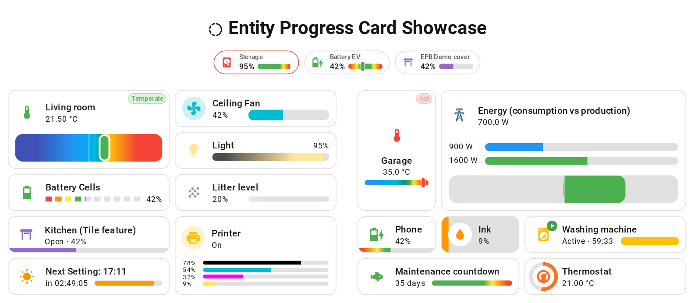
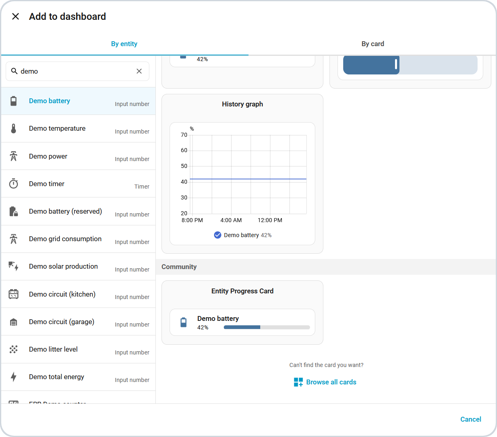
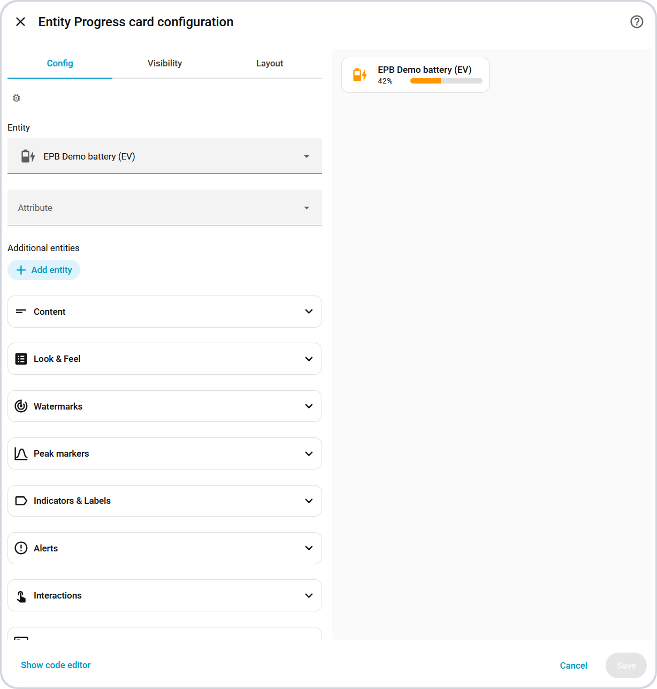
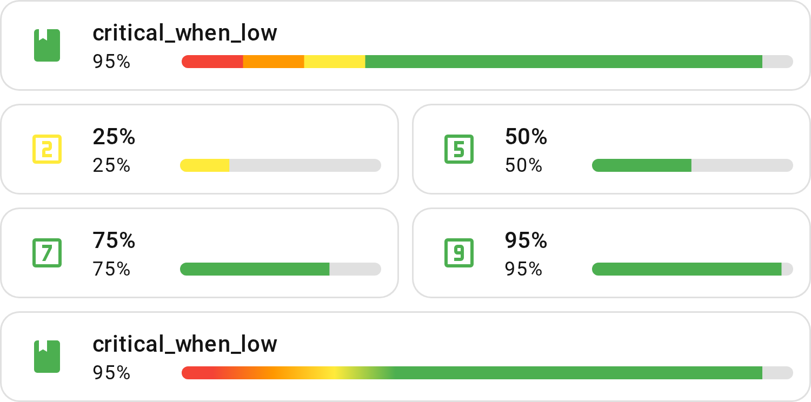

<!-- Generated from .github/README.md by `npm run docs:readme`: do not edit. -->
<!-- markdownlint-disable MD013 -->
<picture>
  <source media="(prefers-color-scheme: dark) and (prefers-reduced-motion: reduce)" srcset="https://raw.githubusercontent.com/francois-le-ko4la/lovelace-entity-progress-card/main/docs/images/epc-logo/epc-icon-black-6f3254.svg">
  <source media="(prefers-color-scheme: dark)" srcset="https://raw.githubusercontent.com/francois-le-ko4la/lovelace-entity-progress-card/main/docs/images/epc-logo/epc-icon-black-hdr-b063b4.jpg">
  <source media="(prefers-reduced-motion: reduce)" srcset="https://raw.githubusercontent.com/francois-le-ko4la/lovelace-entity-progress-card/main/docs/images/epc-logo/epc-icon-dc8ccf.svg">
  
</picture>
<!-- markdownlint-enable MD013 -->

# Lovelace Entity Progress Card

[![Home Assistant][ha-badge]][ha-link]
[![Marketplace][marketplace-badge]][marketplace-link]
[![HACS Custom][hacs-badge]][hacs-link]
[![Latest stable release][release-badge]][release-link]
[![License][license-badge]][GPL-3.0 license]
[![Documentation][docs-badge]][docs-link]
[![Docs (main)][docs-dev-badge]][docs-dev-link]
[![Discord][discord-badge]][discord-link]

A progress bar card for Home Assistant: a battery, a washing machine cycle or a
tank level, shown as a bar with its color and icon.

<!-- markdownlint-disable MD013 -->
<picture>
  <source media="(prefers-color-scheme: dark) and (prefers-reduced-motion: reduce)" srcset="https://raw.githubusercontent.com/francois-le-ko4la/lovelace-entity-progress-card/main/docs/images/showcase-still-dark-1f5e80.png">
  <source media="(prefers-reduced-motion: reduce)" srcset="https://raw.githubusercontent.com/francois-le-ko4la/lovelace-entity-progress-card/main/docs/images/showcase-still-light-f29ca8.png">
  <source media="(prefers-color-scheme: dark)" srcset="https://raw.githubusercontent.com/francois-le-ko4la/lovelace-entity-progress-card/main/docs/images/showcase-loop-dark-dd6ff7.png">
  
</picture>
<!-- markdownlint-enable MD013 -->

> Thousands of Home Assistant dashboards run this card, every day: on a
> wall-mounted tablet, a phone, a screen that never turns off. Read at a glance,
> from across the room.
>
> Add an entity and it's done: the right unit, the right icon, the right math,
> no YAML. Want more? The Template variants take a Jinja template in every
> field.
>
> Not another progress bar: the one that disappears, because it simply does what
> it's supposed to.

## 🚀 Features

- **7 variants, one card**: a dashboard card, a compact badge, a Tile feature,
  or several bars stacked into one; most options carry over between them.
- **Visual editor**: every variant has one, styled like Home Assistant's own. No
  YAML needed to get started.
- **Suggested for you**: in Home Assistant's
  [entity-first card picker](https://developers.home-assistant.io/blog/2026/05/27/custom-card-suggestions/)
  (2026.6+), pick a sensor, light, cover, fan or timer, and the card is offered,
  already filled in.
- **Sensible defaults**: the unit, icon and percentage come from the entity
  itself, before you change anything.
- **Visual effects**: shimmer, glass, water, rainbow or segmented bars, your
  own color zones, and icons that move with the entity's state, with no
  `card_mod`
  ([`bar_effect`][config-bar_effect], [`custom_theme`][config-custom_theme],
  [`icon_animation`][config-icon_animation]). Each one has a screenshot in the
  [Cookbook][cookbook].
- **Alerts**: past a threshold, the card glows, tints its background or shows a
  status pill ([`alert_when`][config-alert_when]).
- **Reference lines**: a mark at a low or high threshold, from a fixed value,
  another entity or a template ([`watermark`][config-watermark]).
- **History**: an ↑/↓ arrow from the real trend, and the lowest, highest and
  average values marked on the bar ([`trend_indicator`][config-trend_indicator],
  [`peak_marker`][config-peak_marker]).
- **Templates**: the Template variants compute the percentage, color, icon and
  text with Jinja, Home Assistant's template language, without a helper sensor.
- **Styling**: every color, spacing and animation is a documented CSS variable,
  to set from your Home Assistant theme or `card_mod` ([Theme Guide]).
- **Accessible**: screen readers announce the value, and motion stops when your
  device asks for reduced motion ([details](#accessibility)).
- **41 languages**: the editor and the card's messages follow your Home
  Assistant language ([list](#-language--numbers)).

<a id="installation"></a>

## 📦 Installation

Requires Home Assistant 2024.0 or newer. The Home Assistant app and any recent
browser work; for an older tablet or wall panel, check the table below.

<a id="prerequisites"></a>

<details>
<summary><strong>Browser compatibility (click to expand)</strong></summary>

|                     | ![HA][ha-logo]<br>**Home Assistant** | ![Chrome][chrome-logo]<br>**Chrome** | ![Edge][edge-logo]<br>**Edge** | ![Firefox][firefox-logo]<br>**Firefox** | ![Safari][safari-logo]<br>**Safari** | ![Opera][opera-logo]<br>**Opera** |
| ------------------- | :----------------------------------: | :----------------------------------: | :----------------------------: | :-------------------------------------: | :----------------------------------: | :-------------------------------: |
| Works               |              `2024.0+`               |                `98+`                 |             `98+`              |                  `94+`                  |               `15.4+`                |               `84+`               |
| Full visual effects |                                      |                `111+`                |             `111+`             |                 `113+`                  |               `16.2+`                |               `97+`               |

> Ensure your Home Assistant instance is up to date to support this custom card.
>
> The first row is the functional minimum — the card loads and works. A handful
> of purely decorative touches (a soft tint behind icons, the pulsing alert/ping
> animations, the bar's gradient sheen) need the newer "Full visual effects"
> versions and gracefully degrade below that: same information, just a little
> less vivid. See the
> [live degraded-mode comparison](https://htmlpreview.github.io/?https://raw.githubusercontent.com/francois-le-ko4la/lovelace-entity-progress-card/main/docs/graphic-effects-compatibility.html)
> for exactly what's affected.
>
> I'm aware upgrading an embedded/kiosk device (a wall-mounted control panel in
> particular, e.g. an older Chromium like Chrome 92 — see
> [issue #128](https://github.com/francois-le-ko4la/lovelace-entity-progress-card/issues/128))
> isn't always simple, so this is a deliberate, pragmatic trade-off rather than
> an oversight: full functionality first, full polish where the browser allows
> it.

</details>

`entity-progress-card` is available in [HACS](https://hacs.xyz) (Home Assistant
Community Store). Since Home Assistant 2026.11, HACS is built in as the
[Marketplace](https://www.home-assistant.io/integrations/marketplace): the steps
below stay the same, under **Marketplace**.

Use this link to go directly to the repository in HACS or the Marketplace:

[](https://my.home-assistant.io/redirect/hacs_repository/?owner=francois-le-ko4la&repository=lovelace-entity-progress-card&category=plugin)

Or, step by step:

1. Open **HACS** (called **Marketplace** from Home Assistant 2026.11). No HACS
   yet? [Install it first](https://hacs.xyz/docs/use/download/download/).
2. Look up **Entity Progress Card**.
3. Click **Download**, then refresh the page (on a tablet: close and reopen the
   app).

<details>
<summary><strong>Manual Installation (click to expand)</strong></summary>

Download `entity-progress-card.js` from the latest release into `/config/www/`,
then declare it as a resource:

- Turn on **Advanced mode** in your user profile if **Resources** is missing.
- Go to **Settings** ➡️ **Dashboards**, open the three-dot menu (**`⋮`**) at the
  top right, then **Resources** ➡️ **Add resource**
- URL: `/local/entity-progress-card.js`
- Type: `JavaScript Module`
- Save, then reload the page (**`CTRL`** + **`F5`** on a computer; on a tablet,
  close and reopen the app)

</details>

> [!NOTE]
>
> The release also carries the visual editor, `entity-progress-card-editor.js`,
> and one `entity-progress-card-<lang>.json` file per language. Copy the editor
> and the language file you need — or all of them — next to the `.js` file:
> without the editor, Home Assistant offers its YAML editor instead; without the
> language file, the visual editor falls back to English. The cards themselves
> work and stay translated either way, and HACS (or the Marketplace) brings
> these files down for you. No extra resource is needed: the card loads them
> from its own folder.

## 📝 Usage

Two ways in: pick the entity and let the card fill itself in, or write the YAML.

### From the card picker

Home Assistant 2026.6 or newer. On an older version, go to [In YAML](#in-yaml).

1. Open Home Assistant's native "Add Card" picker and search for your entity.

   <!-- markdownlint-disable MD013 -->
   <picture>
     <source media="(prefers-color-scheme: dark)" srcset="https://raw.githubusercontent.com/francois-le-ko4la/lovelace-entity-progress-card/main/docs/images/card-picker-dark-6af7b9.png">
     
   </picture>
   <!-- markdownlint-enable MD013 -->

   Example: a light. Type its name and pick it: the bar shows its brightness,
   from 0 to 100 %.

2. Click **Entity Progress Card** — it's already there, pre-filled.
3. Fine-tune it in the visual editor: every option gets its own field, styled
   straight from Home Assistant's own design tokens.

   <details>
   <summary><strong>Show a screenshot of the visual editor</strong></summary>

   <!-- markdownlint-disable MD013 -->
   <picture>
     <source media="(prefers-color-scheme: dark)" srcset="https://raw.githubusercontent.com/francois-le-ko4la/lovelace-entity-progress-card/main/docs/images/editor-dark-72b347.png">
     
   </picture>
   <!-- markdownlint-enable MD013 -->

   </details>

### In YAML

Open your dashboard, select **Edit dashboard**, then **Add card** and
**Manual**. Paste this with your own entity ID (**Settings** ➡️ **Devices &
services** ➡️ **Entities**), then **Save**:

```yaml
type: custom:entity-progress-card
entity: sensor.washing_machine_progress
name: Washing Machine
icon: mdi:washing-machine
```

Want the bar to turn red when a battery runs low (under 10 %)? One line does it:

<!-- markdownlint-disable MD013 -->
<picture>
  <source media="(prefers-color-scheme: dark)" srcset="https://raw.githubusercontent.com/francois-le-ko4la/lovelace-entity-progress-card/main/docs/images/theme-critical-low-dark-dbf8b1.png">
  
</picture>
<!-- markdownlint-enable MD013 -->

```yaml
type: custom:entity-progress-card
entity: sensor.phone_battery_level
theme: critical_when_low
```

Your own limit, red under 20 %? Set your zones with a [custom theme]. A battery
you charge? `theme: battery_adaptive` also warns when it stays near 100 % on the
charger. Every theme, with its colors, is in the [Theme Guide].

Colors, bar styles, alerts: most options work across all **7 variants** — Card,
Template Card, Badge, Badge Template, Tile Feature, Multi-Card, Multi-Feature.
The [option map] shows which ones each accepts.

## 📚 Guides

That's enough to get started. Past that, here's where the rest of the depth
lives — pick whichever guide matches what you're trying to do:

| Guide                                                 | What's in it                                                                                                                                                   |
| ----------------------------------------------------- | -------------------------------------------------------------------------------------------------------------------------------------------------------------- |
| 🍳&nbsp;[Cookbook][cookbook]                          | Ready-made recipes (washing machine brands, an SSL countdown, a sun-tracking bar), a screenshot of every visual effect, and each variant's options at a glance |
| 🎨&nbsp;[Theme&nbsp;Guide][Theme Guide]               | All 12 built-in themes with their exact value ranges, the full `--epb-*` CSS API, and the DOM reference for `card_mod`/UI-X styling                            |
| 📖&nbsp;[Full&nbsp;Configuration&nbsp;Reference][FCR] | Every option, every variant — type, default, and a working example                                                                                             |
| 🗺️&nbsp;[Option&nbsp;map][Option map]                 | Which options each of the 7 variants accepts, in one table                                                                                                     |

<!-- doc-version -->
These guides describe the latest stable release. Testing a release candidate,
or using an older release? Open the
[repository](https://github.com/francois-le-ko4la/lovelace-entity-progress-card)
on GitHub and pick its tag.
<!-- /doc-version -->

## 🚨 Errors, Deprecations & Troubleshooting

A card showing a message is not broken, and nothing in your Home Assistant has
changed: often, an entity is just offline.

- The card says `Unavailable`, `Unknown` or `not found`? See [what it means and
  what to do][unavailable-entities].
- Anything else: the [Errors, Deprecations & Troubleshooting Guide].
- Still stuck? Ask on [Discord] or open a [GitHub issue][GitHub Issues]: a
  screenshot is enough.

<a id="accessibility"></a>

## ♿ Accessibility

The card is designed to work well for everyone, out of the box.

<details>
<summary><strong>Details (click to expand)</strong></summary>

- **Screen readers**: the progress bar exposes proper ARIA semantics
  (`role="progressbar"` with live `aria-valuenow`, including negative ranges in
  `center_zero` mode). Purely decorative elements (fill layers, watermarks, icon
  shape) are hidden from assistive technologies, so the card is announced once,
  with the right value — not as a pile of divs.
- **Reduce Motion**: the card respects the system-level "Reduce Motion" setting
  (iOS/macOS, Android, Windows). When enabled, bar transitions and shimmer
  animations are disabled automatically to prevent dizziness, migraines or
  distraction.
- **Manual control**: animations can also be tuned or disabled per card or per
  theme through the CSS API — e.g. `--epb-progress-transition: none` (see the
  [Theme Guide]).
- **Interactions**: tap, hold and double-tap are handled by Home Assistant's
  native action system, so they behave consistently with official cards.

</details>

<a id="language-and-numbers"></a>

## 🌍 Language & numbers

The card uses the language of your Home Assistant profile and formats numbers
for that region. It is translated into **41 languages**.

<details>
<summary><strong>Full language list & number formatting (click to expand)</strong></summary>

**Supported languages**

<!-- markdownlint-disable MD060 -->

| Flag                                                                                                                                                          | Code    | Language (English / Native)                       |
| ------------------------------------------------------------------------------------------------------------------------------------------------------------- | ------- | ------------------------------------------------- |
| 🇸🇦                                                                                                                                                            | ar      | Arabic / العربية                                  |
| 🇧🇩                                                                                                                                                            | bn      | Bengali / বাংলা                                   |
|  | ca      | Catalan / Català                                  |
| 🇨🇿                                                                                                                                                            | cs      | Czech / Čeština                                   |
| 🇩🇰                                                                                                                                                            | da      | Danish / Dansk                                    |
| 🇩🇪                                                                                                                                                            | de      | German / Deutsch                                  |
| 🇬🇷                                                                                                                                                            | el      | Greek / Ελληνικά                                  |
| 🇬🇧                                                                                                                                                            | en      | English / English                                 |
| 🇪🇸                                                                                                                                                            | es      | Spanish / Español                                 |
| 🌎                                                                                                                                                            | es-419  | Spanish (Latin America) / Español (Latinoamérica) |
| 🇪🇪                                                                                                                                                            | et      | Estonian / Eesti                                  |
| 🇫🇮                                                                                                                                                            | fi      | Finnish / Suomi                                   |
| 🇫🇷                                                                                                                                                            | fr      | French / Français                                 |
| 🇮🇳                                                                                                                                                            | hi      | Hindi / हिन्दी                                    |
| 🇭🇷                                                                                                                                                            | hr      | Croatian / Hrvatski                               |
| 🇭🇺                                                                                                                                                            | hu      | Hungarian / Magyar                                |
| 🇮🇩                                                                                                                                                            | id      | Indonesian / Bahasa Indonesia                     |
| 🇮🇹                                                                                                                                                            | it      | Italian / Italiano                                |
| 🇯🇵                                                                                                                                                            | ja      | Japanese / 日本語                                 |
| 🇰🇷                                                                                                                                                            | ko      | Korean / 한국어                                   |
| 🇱🇹                                                                                                                                                            | lt      | Lithuanian / Lietuvių                             |
| 🇱🇻                                                                                                                                                            | lv      | Latvian / Latviešu                                |
| 🇲🇰                                                                                                                                                            | mk      | Macedonian / Македонски                           |
| 🇳🇴                                                                                                                                                            | nb      | Norwegian Bokmål / Norsk Bokmål                   |
| 🇳🇱                                                                                                                                                            | nl      | Dutch / Nederlands                                |
| 🇵🇱                                                                                                                                                            | pl      | Polish / Polski                                   |
| 🇵🇹                                                                                                                                                            | pt      | Portuguese / Português (Portugal)                 |
| 🇧🇷                                                                                                                                                            | pt-BR   | Portuguese / Português (Brazil)                   |
| 🇷🇴                                                                                                                                                            | ro      | Romanian / Română                                 |
| 🇷🇺                                                                                                                                                            | ru      | Russian / Русский                                 |
| 🇷🇸                                                                                                                                                            | sr      | Serbian (Cyrillic) / Српски (Ћирилица)            |
| 🇷🇸                                                                                                                                                            | sr-Latn | Serbian (Latin) / Srpski (Latinica)               |
| 🇸🇰                                                                                                                                                            | sk      | Slovak / Slovenský                                |
| 🇸🇮                                                                                                                                                            | sl      | Slovene / Slovenščina                             |
| 🇸🇪                                                                                                                                                            | sv      | Swedish / Svenska                                 |
| 🇹🇭                                                                                                                                                            | th      | Thai / ไทย                                        |
| 🇹🇷                                                                                                                                                            | tr      | Turkish / Türkçe                                  |
| 🇺🇦                                                                                                                                                            | uk      | Ukrainian / Українська                            |
| 🇻🇳                                                                                                                                                            | vi      | Vietnamese / Tiếng Việt                           |
| 🇨🇳                                                                                                                                                            | zh-Hans | Chinese (Simplified) / 中文（简体）               |
| 🇹🇼                                                                                                                                                            | zh-Hant | Chinese (Traditional) / 中文（繁體）              |

<!-- markdownlint-enable MD060 -->

> [!IMPORTANT]
>
> I use translation tools to help bridge language gaps, as I'm not fluent in
> every language.
>
> If you notice any mistakes, please understand they are **purely
> unintentional** — feel free to reach out on GitHub or Discord to fix it.

More languages may be added in the future to enhance accessibility!

**Number formatting**

Numbers are displayed based on your regional preferences, using:

- Your selected language settings (auto)
- Your specific format (manual selection)
- Or the system-defined format from your Home Assistant user profile

By default, the card uses standard Arabic numerals (0-9) for maximum
compatibility.

</details>

## 🧪 Code quality

[![CI][ci-badge]][ci-link] [![HACS validation][hacs-ci-badge]][hacs-ci-link]
[![DeepSource][deepsource-badge]][deepsource-link]
[![Dependabot][dependabot-badge]][dependabot-link]
[![TypeScript strict][ts-badge]][ts-link]
[![Code style: Prettier][prettier-badge]][prettier-link]

Every push runs the lint, type-check, tests and build; releases run the same
gate. [DeepSource](https://deepsource.com) reviews the code, and Dependabot
keeps the GitHub Actions up to date.

**Tooling**: [TypeScript][ts-link] · [esbuild](https://esbuild.github.io) ·
[ESLint](https://eslint.org) with
[SonarJS](https://github.com/SonarSource/SonarJS) · [Prettier][prettier-link] ·
[knip](https://knip.dev) ·
[markdownlint](https://github.com/DavidAnson/markdownlint) ·
[happy-dom](https://github.com/capricorn86/happy-dom) ·
[es-check](https://github.com/yowainwright/es-check)

## 👥 Contributing

Want more features? Want to improve this card? Contributions are welcome! 🚀

Check out the [Contributing Guide] to get started.

## 🙏 Credits & Acknowledgements

- **Resources from Home Assistant**  
  ➡️ [Custom Card Documentation](https://developers.home-assistant.io/docs/frontend/custom-ui/custom-card/)

- **Resources from [@thomasloven](https://github.com/thomasloven)** – _thank
  you!_
  <!-- markdownlint-disable-next-line MD013 -->

  ➡️
  [PreLoading Lovelace Elements](https://github.com/thomasloven/hass-config/wiki/PreLoading-Lovelace-Elements)  
  ➡️
  [Custom Element Loader Gist](https://gist.github.com/thomasloven/5f965bd26e5f69876890886c09dd9ba8)

- **Inspired by [Mushroom](https://github.com/piitaya/lovelace-mushroom)**
  **(Apache-2.0 license) —** **Copyright © Paul Bottein
  ([@piitaya](https://github.com/piitaya))**  
  ➡️ For the look & feel

- **Inspired by [bar-card](https://github.com/custom-cards/bar-card)** **(MIT
  License) —** **Copyright © Lucas Bramlage
  ([@Gluwc](https://github.com/Gluwc))**  
  ➡️ No code was copied; this project is an original implementation.

- **Inspired by [superstruct](https://github.com/ianstormtaylor/superstruct)**
  **(MIT License) —** **Copyright © Ian Storm Taylor
  ([@ianstormtaylor](https://github.com/ianstormtaylor))**  
  ➡️ Structural validation ideas to manage inputs (v1.5+). This implementation
  is original and does not reuse code from the library.

- **Inspired by**
  **[hass-progress-bar-feature](https://github.com/ytilis/hass-progress-bar-feature)**
  **(MIT License) —** **Copyright © Yury Tilis
  ([@ytilis](https://github.com/ytilis))**  
  ➡️ override HA's default feature row sizing behavior, preventing card height
  increase when using overlay features.

- **Special thanks to
  [@harmonie-durrant](https://github.com/harmonie-durrant)**  
  ➡️ PRs, HACS testing, debugging, `Light` theme and illustrations:
  - `docs/images/example.png`
  - `docs/images/thumbnail.png`

- **Special thanks to [@jam3sward](https://github.com/jam3sward) &
  [@Duncan1106](https://github.com/Duncan1106)**  
  ➡️ README proofreading and improvements

- **Special thanks to [@mooseBringer](https://github.com/mooseBringer) & @RKT62
  from [Discord]**  
  ➡️ Discord activity  
  ➡️ Regular tests & feedbacks

- **Special thanks to all contributors** – including those who submitted pull
  requests, opened issues, and shared feedback ([GitHub Issues] / [Discord])!

## 📄 License

This project is licensed under the [GPL-3.0 license].

<!-- Links -->

[ha-badge]:
  https://img.shields.io/badge/Home%20Assistant-blue?style=flat&logo=homeassistant&logoColor=white&color=blue
[docs-dev-badge]:
  https://img.shields.io/github/last-commit/francois-le-ko4la/lovelace-entity-progress-card/main?path=docs&label=Docs%20(main)&logo=github&style=flat
[docs-badge]:
  https://img.shields.io/endpoint?url=https%3A%2F%2Ffrancois-le-ko4la.github.io%2Flovelace-entity-progress-card%2Fbadge.json&style=flat
[discord-badge]:
  https://img.shields.io/badge/Discord-%235865F2?style=flat&logo=Discord&logoColor=white&color=%235865F2
[hacs-badge]: https://img.shields.io/badge/HACS-Custom-41BDF5.svg?style=flat
[marketplace-badge]:
  https://img.shields.io/badge/Marketplace-2026.11%2B-41BDF5.svg?style=flat&logo=homeassistant&logoColor=white
[release-badge]:
  https://img.shields.io/github/v/release/francois-le-ko4la/lovelace-entity-progress-card?label=latest%20stable&style=flat&color=blue
[license-badge]:
  https://img.shields.io/github/license/francois-le-ko4la/lovelace-entity-progress-card?style=flat
[ci-badge]:
  https://img.shields.io/github/actions/workflow/status/francois-le-ko4la/lovelace-entity-progress-card/validate-js.yaml?label=CI&style=flat
[hacs-ci-badge]:
  https://img.shields.io/github/actions/workflow/status/francois-le-ko4la/lovelace-entity-progress-card/validate-hacs.yaml?label=HACS%20validation&style=flat
[deepsource-badge]:
  https://app.deepsource.com/gh/francois-le-ko4la/lovelace-entity-progress-card.svg/?label=active+issues
[dependabot-badge]:
  https://img.shields.io/badge/dynamic/yaml?url=https%3A%2F%2Fraw.githubusercontent.com%2Ffrancois-le-ko4la%2Flovelace-entity-progress-card%2Fmain%2F.github%2Fdependabot.yml&query=%24.updates%5B0%5D.schedule.interval&label=Dependabot&logo=dependabot&style=flat
[ts-badge]:
  https://img.shields.io/badge/TypeScript-strict-3178C6?style=flat&logo=typescript&logoColor=white
[prettier-badge]:
  https://img.shields.io/badge/code%20style-prettier-ff69b4?style=flat&logo=prettier&logoColor=white
[ha-link]: https://www.home-assistant.io
[hacs-link]: https://hacs.xyz
[marketplace-link]: https://www.home-assistant.io/integrations/marketplace
[release-link]:
  https://github.com/francois-le-ko4la/lovelace-entity-progress-card/releases/latest
[ci-link]:
  https://github.com/francois-le-ko4la/lovelace-entity-progress-card/actions/workflows/validate-js.yaml
[hacs-ci-link]:
  https://github.com/francois-le-ko4la/lovelace-entity-progress-card/actions/workflows/validate-hacs.yaml
[deepsource-link]:
  https://app.deepsource.com/gh/francois-le-ko4la/lovelace-entity-progress-card/
[dependabot-link]:
  https://github.com/francois-le-ko4la/lovelace-entity-progress-card/blob/main/.github/dependabot.yml
[ts-link]: https://www.typescriptlang.org
[prettier-link]: https://prettier.io
[GPL-3.0 license]:
  https://github.com/francois-le-ko4la/lovelace-entity-progress-card/blob/main/LICENSE
[discord-link]: https://discord.gg/tyMQ2SfyNG
[docs-dev-link]:
  https://github.com/francois-le-ko4la/lovelace-entity-progress-card
[docs-link]: https://francois-le-ko4la.github.io/lovelace-entity-progress-card/
[Discord]: https://discord.gg/tyMQ2SfyNG
[GitHub Issues]:
  https://github.com/francois-le-ko4la/lovelace-entity-progress-card/issues
[Errors, Deprecations & Troubleshooting Guide]: https://francois-le-ko4la.github.io/lovelace-entity-progress-card/troubleshooting/
[unavailable-entities]: https://francois-le-ko4la.github.io/lovelace-entity-progress-card/troubleshooting/#what-you-see-and-what-to-do
[Contributing Guide]: https://francois-le-ko4la.github.io/lovelace-entity-progress-card/contributing/
[Theme Guide]: https://francois-le-ko4la.github.io/lovelace-entity-progress-card/theme/
[custom theme]: https://francois-le-ko4la.github.io/lovelace-entity-progress-card/theme/#custom-theme
[cookbook]: https://francois-le-ko4la.github.io/lovelace-entity-progress-card/cookbook/
[Option map]: https://francois-le-ko4la.github.io/lovelace-entity-progress-card/option-map/
[ha-logo]: https://avatars.githubusercontent.com/u/13844975?s=64&v=4
[chrome-logo]:
  https://raw.githubusercontent.com/alrra/browser-logos/main/src/chrome/chrome_64x64.png
[edge-logo]:
  https://raw.githubusercontent.com/alrra/browser-logos/main/src/edge/edge_64x64.png
[firefox-logo]:
  https://raw.githubusercontent.com/alrra/browser-logos/main/src/firefox/firefox_64x64.png
[safari-logo]:
  https://raw.githubusercontent.com/alrra/browser-logos/main/src/safari/safari_64x64.png
[opera-logo]:
  https://raw.githubusercontent.com/alrra/browser-logos/main/src/opera/opera_64x64.png
[FCR]: https://francois-le-ko4la.github.io/lovelace-entity-progress-card/configuration/
[config-alert_when]: https://francois-le-ko4la.github.io/lovelace-entity-progress-card/configuration/#alert_when
[config-watermark]: https://francois-le-ko4la.github.io/lovelace-entity-progress-card/configuration/#watermark
[config-custom_theme]: https://francois-le-ko4la.github.io/lovelace-entity-progress-card/configuration/#custom_theme
[config-trend_indicator]: https://francois-le-ko4la.github.io/lovelace-entity-progress-card/configuration/#trend_indicator
[config-peak_marker]: https://francois-le-ko4la.github.io/lovelace-entity-progress-card/configuration/#peak_marker
[config-bar_effect]: https://francois-le-ko4la.github.io/lovelace-entity-progress-card/configuration/#bar_effect
[config-icon_animation]: https://francois-le-ko4la.github.io/lovelace-entity-progress-card/configuration/#icon_animation
