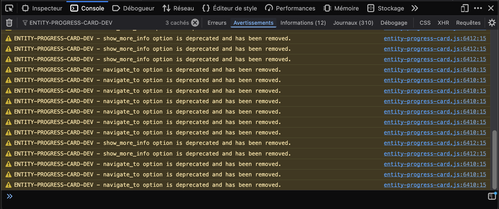
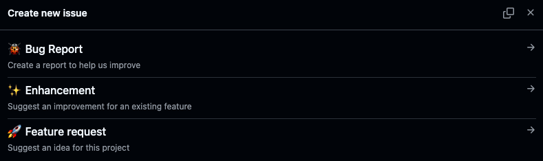

# 🚨 Errors, Deprecations & Troubleshooting

> [!IMPORTANT]
>
> Nothing is broken by this card: it only displays entities and never changes
> your configuration. **Please don't delete your dashboards.**

Start with what you see:

- **The card shows a message**: find it under
  [What you see, and what to do](#what-you-see-and-what-to-do).
- **The card looks flat, grey or empty**: check the same list, then
  [Browser Compatibility](#browser-compatibility).
- **A card changed after an update**, or the editor shows **Migrate config**:
  see [Deprecated Options](#deprecated-options).
- **Something else looks wrong**: see [Other problems](#other-problems).
- **You want to report a problem**: see
  [Copy the issue report from the card editor](#copy-the-issue-report-from-the-card-editor).

Sections marked _Advanced_ use the browser console: skip them, or show them to
whoever set up your Home Assistant.

## Error handling

Not every message means something is broken: the card handles common errors in
your configuration or in an entity's state, and says so on the card itself.

### What you see, and what to do

<!-- markdownlint-disable MD013 -->

**`entity: Required property is missing.`**  
<picture><source media="(prefers-color-scheme: dark)" srcset="images/error-missing-entity-dark-8abb8f.png"></picture>  
The card has no entity. Pick one in the editor, or add `entity:` to the YAML.

**`decimal: Expected type: positive integer.`**  
<picture><source media="(prefers-color-scheme: dark)" srcset="images/error-invalid-value-dark-ba82c3.png"></picture>  
An option has a value it can't use (here, a negative `decimal`). Fix the option
named before the colon.

**`Not found in HA: entity.`**  
<picture><source media="(prefers-color-scheme: dark)" srcset="images/error-not-found-dark-32a40f.png"></picture>  
No entity has this ID: a typo, or a removed entity. Check the ID in **Settings**
➡️ **Devices & services** ➡️ **Entities**.

**`Unavailable`**  
<picture><source media="(prefers-color-scheme: dark)" srcset="images/error-unavailable-dark-4c2fc0.png"></picture>  
The device or integration behind the entity is offline. The card shows what Home
Assistant reports: check the device or the integration, not the card.

**`Unknown`**  
<picture><source media="(prefers-color-scheme: dark)" srcset="images/error-unknown-dark-362114.png"></picture>  
The entity exists but has no value yet. Wait for its first value, or check the
integration.

**`<entity name> unavailable · Unavailable`**  
<picture><source media="(prefers-color-scheme: dark)" srcset="images/error-max-entity-dark-792d61.png"></picture>  
An entity in `min_value` or `max_value` is down: the line names it. Fix that
entity, or use a fixed value.

**`Div0`**  
`min_value` and `max_value` are equal: the bar has no range to fill. Give them
different values.

**`Custom element doesn't exist: entity-progress-card.`**, in red, instead of
the card  
Home Assistant hasn't loaded the card's file: see **Card not loading?** under
[Try common quick checks first](#try-common-quick-checks-first).

<!-- markdownlint-enable MD013 -->

A Jinja template is a value written between `{{ }}`; if you never wrote one,
skip this. A Jinja `min_value` or `max_value` that fails reads
`max_value · JINJA unavailable`: see [Jinja templates](#jinja-templates).

<a id="unavailable-entities"></a>

### When an entity or a Jinja field is unavailable, unknown or not found

A card can depend on several entities (its own `entity`, an entity in
`min_value`, `max_value`, `watermark`, `alert_when`, `bar_stack`) and on Jinja
templates. When one of them cannot give a value, the card does not guess: it
stops drawing what depends on it, and says which one is at fault.

The three states have the same effect:

- `unavailable`: the integration behind the entity is offline.
- `unknown`: the entity exists but has no value yet.
- `not found`: no entity has this ID in Home Assistant (a typo, or a removed
  entity).

#### Required and extra entities

What the bar is drawn from is **required**: without it, any percentage would be
made up. The rest only **adds information** and is dropped on its own.

| Entity                                               | Role     | When it is down                                        |
| ---------------------------------------------------- | -------- | ------------------------------------------------------ |
| The card's `entity`                                  | Required | The bar stops, the state replaces the value            |
| An entity in `min_value` or `max_value`              | Required | The bar stops, the line names the entity               |
| A Jinja template in `min_value` or `max_value`       | Required | The bar stops, the line names the field (see below)    |
| An entity or template in `watermark.low`/`.high`     | Extra    | That mark is not drawn, the bar is unchanged           |
| An entity or template in `alert_when.above`/`.below` | Extra    | That threshold is ignored, it cannot trigger the alert |
| An entity in `bar_stack.entities`                    | Extra    | Left out of the total                                  |

#### What the card shows

When a required entity is down, the bar stops: 0 %, in the disabled color (the
default color for `unknown`), and the value is replaced by a line naming the
cause. The icon and the badge show the matching error look.

- The card's own entity: its state, as Home Assistant words it (`Unavailable`).
- An entity in `min_value` or `max_value`: its name and state, for example
  `sensor.limit · Unavailable`.
- A Jinja template in `min_value` or `max_value`: the field and `JINJA`, for
  example `max_value · JINJA unavailable`.

When several required entities are down at once, the card names the first of
`entity`, `max_value`, `min_value`. Fix it, and the next one shows up if it is
still down.

#### Jinja templates

A Jinja `min_value` or `max_value` can fail in four ways, all shown alike:

- Home Assistant refuses the template (a syntax error, an unknown filter).
- The template has an unclosed delimiter (`{{`, `{%` or `{#`). It is not even
  sent to Home Assistant.
- Home Assistant reports an error while rendering it.
- It renders something that is not a number, such as `unavailable` or `unknown`
  (what `states('sensor.x')` returns for an entity that is down).

The line then reads `max_value · JINJA unavailable`, followed by Home
Assistant's own message instead of `unavailable` when it gives one. The card
also writes a notice in the browser console, once per template, and again when
the template changes.

Until Home Assistant has answered for the first time, a Jinja range is
**waiting**: the bar is grayed and no value is shown. This is not an error, and
it goes away as soon as the template renders a number.

> [!NOTE]
>
> A timer ignores `min_value` and `max_value`: it runs on its own duration. They
> never put a timer in error.

#### Find the cause

_Advanced_: in the [browser console](#open-the-browser-console),
`EPB.doctor.cards()` lists the cards on the page. Its `entity state` column
gives the state and, when it is not the card's own entity, the field at fault:
`⏳ unavailable (max_value)`, or `⏳ unavailable (max_value, Jinja)` for a
template. See [Run the built-in diagnostic](#run-the-built-in-diagnostic).

Then, in Home Assistant:

1. **Settings** ➡️ **Tools** ➡️ **States**: look the entity up. If it is
   missing, check the ID in the card's YAML.
2. **Settings** ➡️ **Tools** ➡️ **Template**: paste the Jinja template. The
   error shown there is the one the card receives.
3. If the entity is `unavailable` or `unknown`, the card shows what Home
   Assistant reports: fix the integration or the device, not the card.

## Deprecated Options

Using an older option? Open the card in the visual editor: if a **Migrate
config** button appears, click it. The card looks the same; only its YAML is
rewritten (see [How migration works](#how-migration-works)).

### What's removed or deprecated

Over time, some configuration options have been deprecated in favor of more
flexible or clearer alternatives. While the card tries to maintain backward
compatibility, these options may stop working in future releases.

In the development of this card, we strive to avoid breaking changes as much as
possible. When such changes are unavoidable, we do our best to support and guide
users through the transition.

In this context, we have two types of deprecated options:

- **Removed**: These were removed to prevent duplication and potential conflicts
  with the new system. It was important to remove them for stability reasons.
- **Deprecated** but still active options: These options may have been used in
  many different cards, and migrating them requires reviewing the configurations
  of all those cards. Therefore, we allow time before disabling them, provide a
  system to detect if you are affected, and will remove them later.

A deprecated option keeps working and writes a warning in the browser console;
most are migrated for the session. A `max_value` repeating its attribute's own
scale migrates without a warning. A removed option is ignored, with a console
warning.

| Option / Value                                                                             | Status         | Replacement / Recommended Action                                     | Since version |
| ------------------------------------------------------------------------------------------ | -------------- | -------------------------------------------------------------------- | ------------- |
| `navigate_to`                                                                              | **Removed**    | Use `tap_action: navigate`                                           | `v1.2.0`      |
| `show_more_info`                                                                           | **Removed**    | Use `tap_action: more-info`                                          | `v1.2.0`      |
| `theme: 'battery'`                                                                         | **Deprecated** | Use `optimal_when_high`                                              | `v1.1.7`      |
| `theme: 'cpu'`                                                                             | **Deprecated** | Use `optimal_when_low`                                               | `v1.1.7`      |
| `theme: 'memory'`                                                                          | **Deprecated** | Use `optimal_when_low`                                               | `v1.1.7`      |
| `max_value: <entity id>`                                                                   | **Deprecated** | Use `max_value: { entity: <id>, attribute: <optional> }`             | `v1.6.0`      |
| `max_value_attribute`                                                                      | **Deprecated** | Fold into `max_value: { entity, attribute }`                         | `v1.6.0`      |
| `disable_unit`                                                                             | **Deprecated** | Use `hide: ['unit', ...]`                                            | `v1.6.0`      |
| `icon_animation: none`                                                                     | **Deprecated** | Omit the option — unset already means no animation                   | `v1.6.2`      |
| `max_value` = the attribute's own scale (`255` for a light's brightness, `1` for a volume) | **Deprecated** | Omit it — the card already rescales to 0-100                         | `v1.6.3`      |
| `show_value` (Multi-Card / Multi-Feature)                                                  | **Deprecated** | Use `hide: [...]` — `false` adds `secondary_info`                    | `v1.6.3`      |
| `value_position` (Multi-Card / Multi-Feature)                                              | **Deprecated** | Use `reverse_secondary_info_row` (`right` → `true`)                  | `v1.6.3`      |
| `additions`                                                                                | **Deprecated** | Use `bar_stack: { mode: 'proportional', entities: [...] }`           | `v1.6.0`      |
| `watermark.low: <entity id>`                                                               | **Deprecated** | Use `watermark.low: { entity: <id>, attribute: <optional> }`         | `v1.6.0`      |
| `watermark.high: <entity id>`                                                              | **Deprecated** | Use `watermark.high: { entity: <id>, attribute: <optional> }`        | `v1.6.0`      |
| `watermark.low_attribute`                                                                  | **Deprecated** | Fold into `watermark.low: { entity, attribute }`                     | `v1.6.0`      |
| `watermark.high_attribute`                                                                 | **Deprecated** | Fold into `watermark.high: { entity, attribute }`                    | `v1.6.0`      |
| `watermark.low_as`, `low_color`, `disable_low` (and `high_*`)                              | **Deprecated** | Use `watermark.low: { value, as, color }`, or `false` to hide a side | `v1.6.2`      |
| `text_shadow`                                                                              | **Deprecated** | Use `text_effect: shadow`                                            | `v1.6.4`      |

<details>
<summary><strong>Show the console warnings (click to expand)</strong></summary>
<!-- markdownlint-disable-next-line MD013 -->

</details>

### How migration works

You don't have to rewrite anything by hand:

- **Deprecated** options (table above) keep working exactly as before — the card
  understands them internally and applies the modern equivalent automatically,
  whether or not you ever open the editor.
- **Removed** options (`navigate_to`, `show_more_info`) have had no effect for a
  long time already; migrating just cleans them up rather than guessing a
  replacement for something that hasn't run in years.

When you open the visual editor on a card that still uses a legacy option, a
**Migrate config** button appears in the top-right corner. One click rewrites
your YAML to the current syntax — the rendered card doesn't change, only how
it's written. If you already wrote the new option next to the old one, the new
one is what counts: the old one is simply removed.

The same button shows up for an option that has no effect where it is set —
`text_effect` on a bar that isn't `overlay` or `background`, a `bar_color_mode`
without a theme. The click takes it out of your YAML; undo the change that made
it pointless while the editor is still open, and it comes back as it was.

To find every card that needs it, on every dashboard — views you never open
included — run this in the [browser console](#open-the-browser-console) on any
dashboard:

```js
EPB.doctor.audit();
```

It lists each card with its deprecated options and those without effect, and
Multi cards whose rows switched to the 1.6.3 look (icon, name and value) because
their config never said otherwise.

As with any edit: check that the card still looks right, and that the values it
displays match what you expect, before saving the dashboard.

## Other problems

### Browser Compatibility

Some issues aren't a bug — the browser is simply below the supported version.

The card needs Home Assistant 2024.0 or newer, and Chrome or Edge 98+, Firefox
94+, Safari 15.4+ or Opera 84+. A few decorative touches (icon tint, alert/ping
pulse, bar gradient sheen) need newer versions; on older browsers they are
simply not shown, and the values stay the same. Is your browser too old? See the
[compatibility table](../README.md#prerequisites) and the [graphic effects
compatibility overview].

- **Older Chromium (e.g. Chrome 92, common on wall-mounted tablets)**: the card
  loads and works (see [issue #128]). We do our best to keep it compatible,
  though a few details may look slightly different.

### Quick checks and reporting

#### Try common quick checks first

- **Already on the latest version?**  
  **Fix:** check your installed version against the [latest release] — the
  Marketplace (HACS before Home Assistant 2026.11) flags an update under
  **Settings** ➡️ **Updates** when one is available. It can lag before it shows
  a new release though: if your version looks outdated but no update is offered,
  go to **Settings** ➡️ **Marketplace**, search for the card, then **⋮** ➡️
  **Install another version** to install the current release rather than
  waiting.
- **A pre-release (RC) already fixes it?**  
  **Fix:** patches and new features often ship first as a release candidate
  (`x.y.z-rcN`) before the stable release. Check [all releases] (includes
  pre-releases) — your issue may already be fixed there. To try one, see
  [Testing a Release Candidate](rc-testing.md).
- **Card not loading?**  
  **Fix:** check that the card is listed in **Settings** ➡️ **Dashboards** ➡️
  **⋮** ➡️ **Resources**, with the type **JavaScript Module**. No **Resources**
  entry? Turn on **Advanced mode** in your user profile, or ask whoever set up
  Home Assistant.
- **The Marketplace not detecting the card?**  
  **Fix:** try clearing your browser cache or restarting Home Assistant.
- **Card missing gradients/pulse animations, or looks a bit flat?**  
  **Fix:** likely just an older browser — see
  [Browser Compatibility](#browser-compatibility) above.
- **Card not rendering, a `Cannot use 'import.meta' outside a module` error, or
  pop-ups (e.g. browser_mod) freezing?**  
  **Cause:** your resource is registered as a classic **"JavaScript"** type
  (deprecated by Home Assistant) instead of **"JavaScript Module"**. HA loads
  classic scripts differently, and older builds couldn't survive it — the card
  failed to load and could freeze browser_mod pop-ups (see [issue #108]).
  **Fix:** in **Settings** ➡️ **Dashboards** ➡️ **⋮** ➡️ **Resources**, open the
  entry, set **Resource type → JavaScript Module**, then hard-refresh (reload
  without the cache: `Ctrl`/`Cmd` + `Shift` + `R`). This changes only that
  entry, not your dashboards. (Recent builds load correctly either way and print
  a console warning when they detect the classic type.)
- **The visual editor doesn't open — Home Assistant shows its YAML editor
  instead?**  
  **Fix:** the editor ships beside the card in `entity-progress-card-editor.js`,
  and loads the first time you open one. A manual install needs that file next
  to `entity-progress-card.js`; the console says why it didn't load
  (`Visual editor unavailable: …`). Right after an update, hard-refresh: a card
  still cached from the previous version refuses the new editor.
- **Still not working?**  
  **Fix:** look for errors in the [browser console](#open-the-browser-console).

#### Open the browser console

_Advanced_. Press **`F12`** (Mac: **`⌘`** + **`⌥`** + **`I`**), then open the
**Console** tab. Safari needs its **Develop** menu first: see below.

<details>
<summary><strong>Each browser, step by step (click to expand)</strong></summary>

**Firefox**

- Keyboard: **`F12`** or **`Ctrl`** + **`Shift`** + **`K`** (Mac: **`⌘`** +
  **`⌥`** + **`K`**)
- Menu: the **`≡`** menu (top-right) ➡️ **Web Developer** ➡️ **Web Console**

**Chrome / Chromium**

- Keyboard: **`F12`** or **`Ctrl`** + **`Shift`** + **`J`** (Mac: **`⌘`** +
  **`⌥`** + **`J`**)
- Menu: the **`⋮`** menu (top-right) ➡️ **More tools** ➡️ **Developer tools**,
  then the **Console** tab

**Safari**

- Keyboard: **`⌘`** + **`⌥`** + **`C`**
- Menu: enable the Develop menu first, in **Safari** ➡️ **Preferences** ➡️
  **Advanced** ➡️ **Show Develop menu in menu bar**; then **Develop** ➡️ **Show
  JavaScript Console**

**Opera**

- Keyboard: **`Ctrl`** + **`Shift`** + **`I`** (Mac: **`⌘`** + **`⌥`** +
  **`I`**)
- Menu: the **O** menu (top-left) ➡️ **Developer** ➡️ **Developer tools**, then
  the **Console** tab

**Edge**

- Keyboard: **`F12`** or **`Ctrl`** + **`Shift`** + **`I`** (Mac: **`⌘`** +
  **`⌥`** + **`I`**)
- Menu: the **`⋯`** menu (top-right) ➡️ **More tools** ➡️ **Developer tools**,
  then the **Console** tab

</details>

#### Copy the issue report from the card editor

The quickest way: open the card in the visual editor and click the bug icon in
its top-left corner. It copies a report ready to paste into your issue — the
diagnostic below, then the card's YAML with its deprecated options and options
without effect marked, and a `# drawn from:` comment with the range and value
the bar is drawn from. On a Multi card, use the icon on the card itself, not on
one of its rows. The issue will be public: read the report before posting it.

#### Run the built-in diagnostic

_Advanced_. The card ships with a small diagnostic helper that collects the same
information in one shot. Open the [browser console](#open-the-browser-console)
on any dashboard, and run:

```js
EPB.doctor.dump();
```

> [!NOTE]
>
> On a development build the helper answers to `EPB_DEV` instead, and on a copy
> loaded with `?suffix=rc` to `EPB_RC`: each copy keeps its own. `EPB.help()`
> lists every command; the former `EPB_DIAG.dump()` still works.

To look at one card in particular:

| Command                 | What it shows                                                                                                                                                                                                                                                                                       |
| ----------------------- | --------------------------------------------------------------------------------------------------------------------------------------------------------------------------------------------------------------------------------------------------------------------------------------------------- |
| `EPB.doctor.cards()`    | The cards on the page, numbered, each with a `config` state (`✅ ok`, `❌ invalid`, `⚠️ deprecated`, `🧹 no effect`, `🎨 new look`), an `entity state` (`✅ ok`, `⏳ unavailable`, `❓ unknown`, `🚫 not found`), the findings in `details` and a `drawn` line (`min 0 · max 100 · value 42 · 42%`) |
| `EPB.doctor.inspect(2)` | Card 2: the value and the range its bar is drawn from, and the config it ended up with; `EPB.doctor.inspect($0)` takes the card picked in the DevTools' Elements tab                                                                                                                                |
| `EPB.doctor.jinja(2)`   | Card 2's Jinja fields, each with Home Assistant's last result or error                                                                                                                                                                                                                              |
| `EPB.doctor.history(2)` | The samples behind card 2's `trend_indicator` and `peak_marker`                                                                                                                                                                                                                                     |
| `EPB.doctor.copy(2)`    | An issue report for card 2, the same as the editor's bug icon, copied when the browser allows (otherwise run `copy($_)` right after)                                                                                                                                                                |

`EPB.doctor.dump()` prints an anonymized report — card and Home Assistant
versions, browser, dark mode / reduced motion status, registered card types,
whether the required HA components (`ha-card`, `ha-selector`, `action-handler`)
are present, and where the visual editor is loaded from and whether it loaded —
ready to copy/paste into your issue. Chrome, Edge and Opera only give their
exact version and operating system over HTTPS; elsewhere, the user agent line is
all there is.

It also flags a **duplicate resource load** on its own
(`duplicate load: ⚠️ YES`, followed by the URLs loaded) — a common,
hard-to-diagnose cause of erratic behavior where the card ends up installed
**twice** (e.g. via the Marketplace _and_ a leftover manual resource in
**Settings** ➡️ **Dashboards** ➡️ **⋮** ➡️ **Resources**). If you see this
warning, remove the extra resource entry first — it resolves most "impossible to
reproduce" issues on its own.

The `sha-256` lines give the first 12 characters of the card and editor files as
your browser received them: compare them with the `sha256:` digest GitHub shows
beside each file of the release to make sure you run the published one. They
need HTTPS.

#### Enable debug logging (`?debug=…`)

_Advanced_. For harder cases, the card can print detailed per-area logs to the
browser console — no special build required. Open the card's entry in
**Settings** ➡️ **Dashboards** ➡️ **⋮** ➡️ **Resources**, keep its URL as it is
and add `?debug=…` at the end (`&debug=…` when the URL already has a `?`), e.g.:

```text
/local/community/lovelace-entity-progress-card/entity-progress-card.js?debug=card,registration
```

Reload the page (a hard refresh, `Ctrl`/`Cmd` + `Shift` + `R`). A console
warning confirms which areas are active. Available areas (comma-separated, or
`all`):

| Area                 | What it logs                                                                              |
| -------------------- | ----------------------------------------------------------------------------------------- |
| `card`               | Card lifecycle — connect / disconnect / **document move** / config / refresh, with timing |
| `registration`       | Custom-element registration order, duplicates, and card-picker entries                    |
| `instances`          | A per-class object-creation counter (spot leaks / over-rendering)                         |
| `interference`       | When **another module** changes this card's host element from outside                     |
| `editor`             | The visual editor: config in, `config-changed` out                                        |
| `interactionHandler` | tap / hold / double-tap action resolution                                                 |
| `hass`               | First hass, HA core version, language changes                                             |
| `ressourceManager`   | Timers / listeners / template subscriptions (spelled as in the code)                      |

For a card that misbehaves only when other cards/modules are present,
`?debug=card,registration,interference` is the most useful combination — it
shows lifecycle churn, registration problems, and outside interference at once.
Copy the console output into your issue.

Without access to the resource URL, `EPB.debug('card,registration')` in the
console keeps the same areas on in this browser, across reloads; reload the page
to apply it, and run `EPB.debug(false)` to turn them off. `EPB.debug()` shows
what is saved.

> [!NOTE]
>
> `?debug=…` and `EPB.debug()` only turn logging on — they change nothing else.
> Remove the query, or run `EPB.debug(false)`, once you're done.

#### Or gather the information by hand

If neither the editor nor the console is at hand, note:

- Home Assistant version
- Browser used
- YAML configuration snippets (if relevant)
- Any visible error messages (from the console or logs)

#### Open an issue on GitHub

You don’t need to be a developer to report an issue! Whether you're a beginner
or an advanced user, your feedback is valuable!

- Before creating a new issue, please first
  **[check existing issues](https://github.com/francois-le-ko4la/lovelace-entity-progress-card/issues)**
  to see if the problem has already been reported.
- If not, feel free to
  **[submit a new issue](https://github.com/francois-le-ko4la/lovelace-entity-progress-card/issues/new/choose)**
  with all the relevant information. You need a free GitHub account.

> [!NOTE]
>
> When opening an issue, try to include as much information as possible.
>
> The more context you provide, the faster and more accurately we can help -
> we’ll troubleshoot it together!
>
> To help you out, we’ve set up a simple system that asks you the right
> questions and guides you through the process of creating a useful issue.

  <details>
  <summary><strong>Show the issue choices (click to expand)</strong></summary>
  <!-- markdownlint-disable-next-line MD013 -->
  
  </details>

#### Roll back

If you recently **updated** the card and the issue started afterward, first
[open an issue on GitHub](#open-an-issue-on-github) so the problem gets fixed in
the next release. Meanwhile, go to **Settings** ➡️ **Marketplace**, search for
the card, then **⋮** ➡️ **Install another version**, and pick the previous one.

Your dashboards stay intact.

[latest release]:
  https://github.com/francois-le-ko4la/lovelace-entity-progress-card/releases/latest
[all releases]:
  https://github.com/francois-le-ko4la/lovelace-entity-progress-card/releases
[issue #108]:
  https://github.com/francois-le-ko4la/lovelace-entity-progress-card/issues/108
[issue #128]:
  https://github.com/francois-le-ko4la/lovelace-entity-progress-card/issues/128
[graphic effects compatibility overview]:
  https://htmlpreview.github.io/?https://raw.githubusercontent.com/francois-le-ko4la/lovelace-entity-progress-card/main/docs/graphic-effects-compatibility.html
